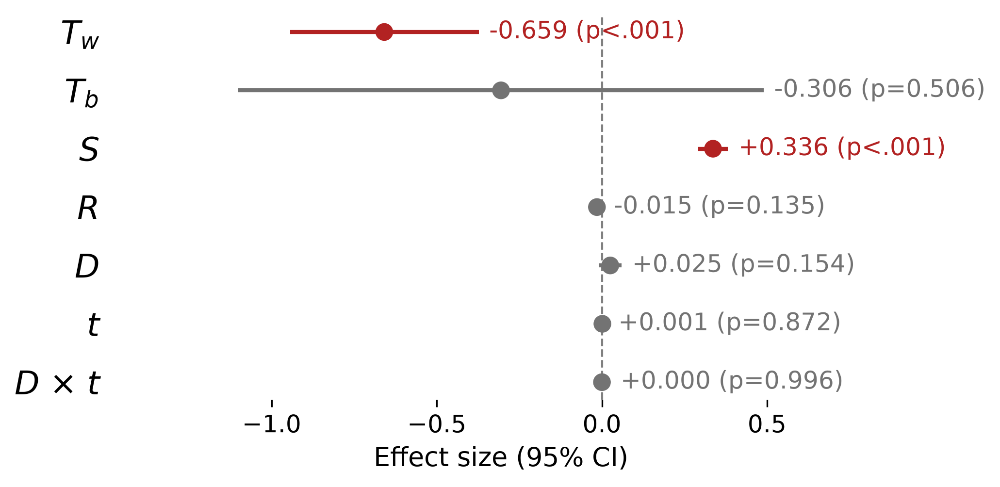
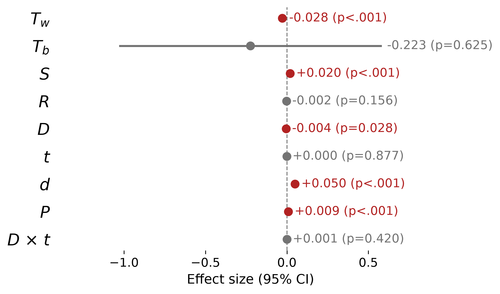
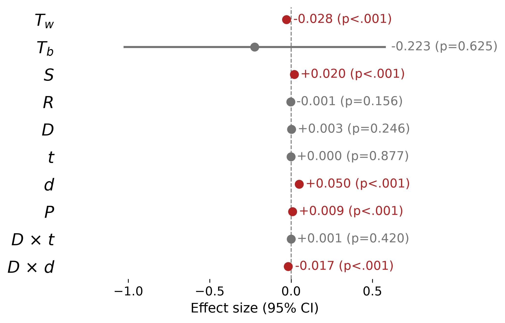
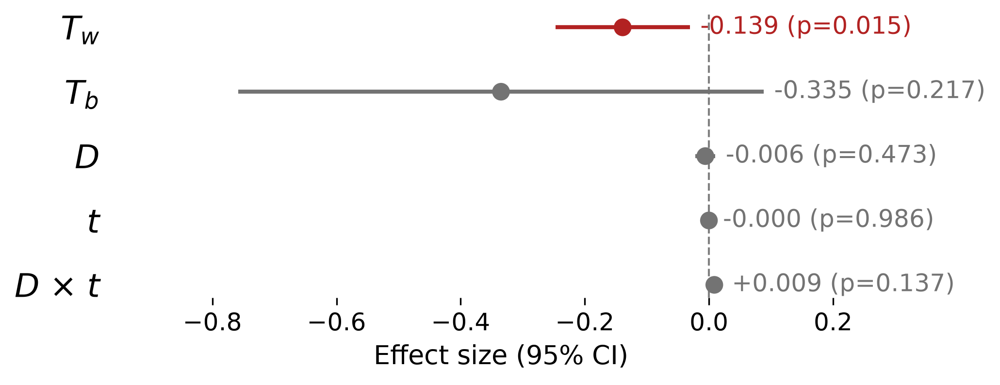
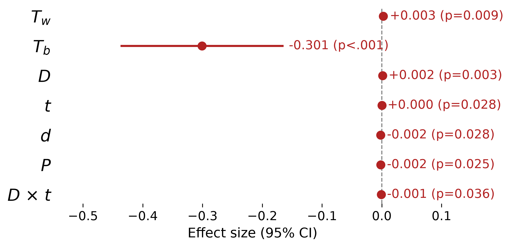

# GLMM 결과 요약 — Curriculum order and transfer

주로 두 질문에 대한 대답을 중심으로 결과를 정리함 

1. **Does the training order matter?** — forward vs reverse curriculum
2. **Does anything transfer to untrained perception?** — held-out benchmarks (BlindTest, MMVP)

- 응답변수는 전부 **delta = acc − Base**, 즉 *change from the untrained model* (정확도 단위)
- 두 종류의 acc 를 따로 모형화한다: 모델 자신의 **inference accuracy** 와 hidden state 에서 답을 복원하는 **probe accuracy**
- `lme4`/`lmerTest` 선형혼합모형 

---

| 논문 | 주장 | GLMM 분석결과 발견한 통계적 근거 |
|---|---|---|
| §5.1 Order makes no systematic difference | 두 방향이 거의 같은 결과에 도달한다 | **§1** — `D` p=0.154, `D×t` p=0.996 (battery inference) |
| §5.2 The curriculum changes readout, not representations | 학습이 고치는 것은 이미 있던 정보를 읽어내는 **readout** 이지 representation 이 아니다 | **§2** — 같은 학습 사건에 대해 inference **+33.6%p** vs probe **+2.1%p** (약 1/16) |
| §5.2 (probe profiles by depth) | 정보는 상위 층에 있고 projector 단계에서는 태스크에 따라 낮다 | **§2** — `d` +5.0%p / depth 1단위, `P` +0.95%p |
| §6.2 Performance does not transfer | 학습이 held-out benchmark 성능을 증가시키지 않는다 | **§4** — `t` p=0.986, `D×t` p=0.137. benchmark type 별로 나눠도 동일 |
| §6.3 The gap persists on untrained tasks | representation-utilization gap 이 untrained task 에서도 여전히 존재한다 | **§5a** — BlindTest 에서 `d` 가 유의하지 않고(p=0.128, battery 는 +0.050) 검출되는 변화는 다섯 stage 동안 headroom 의 약 10% |
| §6.2 (보강) "net change is small and **mixed in sign**" | 전이가 없다는 것이 "아무 변화 없음"은 아니다 | **§4b** — task × model 45셀 중 24셀이 유의(FDR): 상승 7, **하락 17**. 평균이 상쇄하고 있었다 |
| — (논문에 없는 추가 발견) | 학습 반응은 모델·과제마다 다르지만, 방향 결론은 어떤 specification 에서도 안 바뀐다 | **§4c/§5c** — inference 는 `model×t` p=0.026·`task×t` p=0.035 (둘 다 FDR 후 개별 효과 없음), probing 은 `model×t` **p=5e−08** 인데 `task×t` 는 널(p=0.53). `D×t` 는 전 specification 에서 유지 |
| §5.2 "The reverse curriculum shows the same probe profiles" | 두 방향의 probe profile 이 같다 | **§3 — 부분적 반례.** `D×d` = −0.0172 (p<0.001): reverse 쪽 depth 기울기가 더 가파르다 (최종층 기준 +1.4%p). 탐색적이며 held-out 에서 재현 안 됨. 그러나 뭐 아주 심하지 않다는 정도로 이 방향 자체가 큰 영향은 없다고 얘기할 법 한 듯 |

---

## 요약

1. **Order-agnostic.** battery inference 에서 방향의 평균차(`D`, p=0.154)도 학습 속도차(`D×t`, p=0.996)도 없다. 두 curriculum 이 결국 같은 다섯 stage 를 모두 돌기 때문이며, 순서가 만드는 차이는 **각 ability 를 언제 배웠는가**(`S`, +33.6%p) 안에 있고 태스크마다 정반대라 평균에서 상쇄된다.
2. **Readout, not representations.** 자기 stage 를 학습하면 inference 는 **+33.6%p** 오르지만 같은 사건에 대한 probe 는 이미 잘하고 있을 뿐더러 **+2.1%p** 밖에 안 움직인다. 정보는 이미 vision tower에 있었고 그것을 **읽어내는 능력**이 언어 모델에서 학습되는 중이다- 라는 논문의 서술과 일치한다.
3. **정보는 위쪽 층에 있다.** probe delta 는 LM depth 1단위당 **+5.0%p** 로 깊을수록 크고, projector 는 첫 층 대비 +0.95%p. 다시 말해서 중요한 정보는 위쪽으로 갈 수록 많아진다는 뜻이다.
4. **No transfer learning.** 간단히 말하면 task curriculum 을 학습하는게 benchmark 데이터셋에서는 큰 영향이 없다. held-out benchmark inference 는 학습량(`t`, p=0.986)에도 방향(`D×t`, p=0.137)에도 반응하지 않는다. representation 쪽은 BlindTest 와 MMVP 를 나눠 봤는데 — BlindTest 는 **어느 층에서도 자라지 않고**(`d` p=0.128, battery 는 +0.050) 다섯 stage 동안 +0.34%p 움직일 뿐이며, MMVP 는 오히려 −0.9%p **내려간다**. 여전히 방향과 상관없는 것 같다. 다만 **BlindTest 8과제 중 5개가 세기(counting) 과제인데 battery 에는 counting stage 가 없어서**, 애초에 겹치는 능력이 거의 없었다는 점은 한계로 같이 봐야 한다 (§4).
5. **task batery 랑 benchmark 에 대한 probing 에서 비교** battery probing 에서 `direction × LM depth` 상호작용이 유의하다 (`D×d` = −0.0172, p<0.001). reverse curriculum 이 상위 층 representation 을 조금 더 키운다는 뜻이지만(최종층 +1.4%p), 그렇다고 해서 benchmark 에서는 이런게 나타나지 않는다. 여전히 결론은 유사하게 학습이 benchmark 에 transfer learning 의 효과는 없다고 얘기할만한 상태
6. **"전이 없음"은 "변화 없음"이 아니다.** held-out inference 를 task × model 45셀로 쪼개면 24셀이 유의하게 움직인다 — **상승 7, 하락 17**. 즉 커리큘럼 학습은 benchmark 를 평균적으로 못 올릴 뿐 아니라 **망가뜨리는 쪽이 두 배 이상 많다** (§4b). FDR 을 통과하는 task 는 `subway connections` 하나인데 그것도 VILA-3B 한 모델이 만든 것이다.
7. **이질성은 model 에 있지 task 에 있지 않다 (probing).** `model` 을 고정효과로 올려 `time_c` 와 상호작용시키면 probing 에서 `model×t` 가 **p=5e−08** 로 강하게 유의한 반면 `task×t` 는 널(p=0.53)이다. 게다가 §5a 의 "다섯 stage 동안 +0.34%p" 드리프트는 **OpenFlamingo 한 모델이 전부** 만든 것으로, 나머지 네 모델의 held-out representation 은 문자 그대로 정지해 있다 (§5c). 이질성을 다 넣어도 `D×t` 결론은 유지된다.
8. **정보는 대부분 이미 encoder 출력에 있다 (§6).** held-out BlindTest 8과제 전부에서 projector probe 가 **0.92~1.00** 인데 LM 을 통과해도 늘지 않고(built ≈ 0, 일부는 음수) 행동은 0.03~0.23 에 머문다 — **utilization gap 0.72~0.96.** 즉 LM 은 정보를 만들지도, 쓰지도 않는다. 유일한 예외가 S0(글자)로 projector 0.128 → LM 0.893 (**+0.766**) 으로 **LM 안에서 조립**되고, MMVP 는 반대로 inference 가 모든 probe 를 넘어선다.

---

## 읽는 법 — 기호

그림의 y축은 기호이고, 계수는 전부 **정확도 단위**(0.01 = 1%p)의 delta 변화량이다.

| 기호 | 코드 | 의미 (논문 용어) |
|---|---|---|
| $T_w$ | `base_wi` | **task-specific Base level** — 그 모델이 이 task 를 유난히 잘하는가 ($\bar{T}_{m,t}-\bar{T}_m$) |
| $T_b$ | `base_bw` | **model-level Base level** — 전반적으로 강한 모델인가 ($\bar{T}_m-\bar{T}$) |
| $S$ | `trained_yet` | 그 task 의 stage 를 이미 학습했는가 (0/1). battery 전용 |
| $R$ | `recency` | 자기 stage 종료 후 경과 stage 수 — forgetting 축 |
| $D$ | `direction` | **curriculum direction**, 대비코딩 (forward = +0.5, reverse = −0.5) → 계수 = forward − reverse |
| $t$ | `time_c` | 중심화한 training time (stage 1..5 → −2..2) → 계수 = **두 방향 평균** 기울기 |
| $d$ | `depth_num` | **relative LM depth** (0 = LM 입력, 1 = 최종층), 모델별 정규화 |
| $P$ | `is_proj` | **projector output** 지시변수 (LM depth 축과 별도) |

> **부호 규약.** ±0.5 대비코딩이므로 `D` 가 양수면 **forward 가 크다**. 이전 더미코딩(`directionreverse`) 기준 문서·그림과는 부호가 반대다. `D×t` 의 크기와 p 값은 코딩과 무관하게 동일하다.

$T_w$, $T_b$ 가 음수인 것은 정상이다 — 응답이 delta 라 "Base 가 높으면 덜 오른다"(ceiling·regression to the mean)를 잡는다.

---

## 1. Battery · inference accuracy — *Order makes no systematic difference*



`delta ~ base_wi + base_bw + trained_yet + recency + direction * time_c + (1|model) + (1|task) + (1|model:task)`
관측 245행 (model:task 25, task 5, model 5)

| 기호 | 항 | 추정치 | 95% CI | p |
|---|---|---:|---|---|
| $T_w$ | `base_wi` | -0.6590 | [-0.9448, -0.3732] | <0.001 *** |
| $T_b$ | `base_bw` | -0.3056 | [-1.1010, +0.4898] | 0.506 |
| $S$ | `trained_yet` | +0.3363 | [+0.2910, +0.3816] | <0.001 *** |
| $R$ | `recency` | -0.0152 | [-0.0350, +0.0047] | 0.135 |
| $D$ | `direction` | +0.0252 | [-0.0093, +0.0596] | 0.154 |
| $t$ | `time_c` | +0.0014 | [-0.0150, +0.0178] | 0.872 |
| $D\times t$ | `direction:time_c` | +0.0001 | [-0.0244, +0.0245] | 0.996 |

**해석.** 각 ability 는 자기 stage 에서 습득되고 그 뒤로 유지된다 — `S` = **+33.6%p**. 이어지는 stage 들이 앞서 배운 ability 를 덮어쓰지 않는다 (즉 이전에 학습한걸 잊어버리는 효과는 없다) 이것은 `R`(forgetting)이 −1.5%p/stage 로 유의하지 않다는 데서 확인된다 ("adds abilities rather than overwriting earlier ones").

방향은 **평균 수준(`D`)에서도 학습 속도(`D×t`)에서도 차이가 없다.** 논문의 "The two directions reach almost the same result" 를 그대로 지지한다. 다만 이것이 *순서가 무의미하다*는 뜻은 아니다 — 순서가 실제로 하는 일은 `S`(각 task 를 언제 배웠는가)에 흡수되고, 두 방향이 같은 다섯 stage 를 모두 통과하므로 task 평균에서는 상쇄된다는 것을 의미한다.

`T_w` = −0.66 은 Base 에서 이미 잘하던 task 일수록 덜 오른다는 뜻으로, depth ordering(S4)처럼 Base 가 chance 근처인 task 가 여기서 제외되는 것은 아니다 — 그 task 들이 안 오르는 이유는 별개이며 probing accuracy 에서 확인할 수 있다.

## 2. Battery · probe accuracy — *The curriculum changes readout, not representations*



`delta ~ base_wi + base_bw + trained_yet + recency + direction * time_c + depth_num + is_proj + (1|model) + (1|task) + (1|model:task) + (1|cell)`
관측 1500행 (cell 250, model:task 25, task 5, model 5)

| 기호 | 항 | 추정치 | 95% CI | p |
|---|---|---:|---|---|
| $T_w$ | `base_wi` | -0.0278 | [-0.0370, -0.0186] | <0.001 *** |
| $T_b$ | `base_bw` | -0.2234 | [-1.0295, +0.5827] | 0.625 |
| $S$ | `trained_yet` | +0.0205 | [+0.0158, +0.0252] | <0.001 *** |
| $R$ | `recency` | -0.0015 | [-0.0036, +0.0006] | 0.156 |
| $D$ | `direction` | -0.0040 | [-0.0076, -0.0005] | 0.028 * |
| $t$ | `time_c` | +0.0001 | [-0.0016, +0.0018] | 0.877 |
| $d$ | `depth_num` | +0.0503 | [+0.0441, +0.0565] | <0.001 *** |
| $P$ | `is_proj` | +0.0095 | [+0.0040, +0.0150] | <0.001 *** |
| $D\times t$ | `direction:time_c` | +0.0010 | [-0.0015, +0.0036] | 0.420 |

**해석 — 이게 중요한 결과** 같은 학습 사건(`S`)에 대해

- **inference** 는 **+33.6%p** 오르고 (위의 1 분석)
- **representation** 은 **+2.1%p** 움직인다 — 약 **1/16**로 그 효과 크기가 작다.

논문의 "What the curriculum repairs is therefore the readout of information the models already had, not the information itself" 를 수치로 표현한 것이다. probe 가 통계적으로 0이 아닌 것(p<0.001)은 사실이지만, 크기가 행동 변화의 한 자릿수 아래이고 battery probe 가 Base 에서 이미 0.86~0.95 로 높아 **올라갈 여지 자체가 작다**는 점을 언급해야한다.

representation 이 어디에 있는지도 나온다. **`d` = +5.0%p / relative depth 1단위** — 변화는 상위 층에 집중된다. `P` = +0.95%p 로 projector 출력은 LM 입력(depth 0) 대비 위에 있지만 상위 층에는 못 미친다. 논문이 S0 에 대해 지적한 "letter identity is assembled inside the language model rather than delivered linearly by the projection" 과 같은 방향이다. 즉 학습에 의해 영향 받는건 위쪽 layer에서 기존 representation 을 읽어내는 능력, readout 이다.

`D` = −0.40%p (p=0.028) 가 유의하지만, 아래 §3 에서 depth 상호작용을 넣으면 사라진다(p=0.246). 즉 **평균 수준의 방향차가 아니라 depth 에 실린 차이**다.

## 3. Battery · direction × LM depth (exploratory)

이건 모델에 interaction term 을 넣어서 추가분석한 결과다



§2 모형에 `direction * depth_num` 추가. 관측 1500행.

| 기호 | 항 | 추정치 | 95% CI | p |
|---|---|---:|---|---|
| $T_w$ | `base_wi` | -0.0277 | [-0.0369, -0.0186] | <0.001 *** |
| $T_b$ | `base_bw` | -0.2234 | [-1.0295, +0.5827] | 0.625 |
| $S$ | `trained_yet` | +0.0205 | [+0.0158, +0.0252] | <0.001 *** |
| $R$ | `recency` | -0.0015 | [-0.0036, +0.0006] | 0.156 |
| $D$ | `direction` | +0.0031 | [-0.0022, +0.0084] | 0.246 |
| $t$ | `time_c` | +0.0001 | [-0.0016, +0.0018] | 0.877 |
| $d$ | `depth_num` | +0.0503 | [+0.0441, +0.0565] | <0.001 *** |
| $P$ | `is_proj` | +0.0095 | [+0.0040, +0.0150] | <0.001 *** |
| $D\times t$ | `direction:time_c` | +0.0010 | [-0.0015, +0.0036] | 0.420 |
| $D\times d$ | `direction:depth_num` | -0.0172 | [-0.0266, -0.0078] | <0.001 *** |

깊이별 forward↔reverse 차이 (이전 실행의 emmeans, reverse − forward):

| relative LM depth | reverse − forward | p |
|---|---|---|
| 0.00 | −0.0031 | 0.246 |
| 0.25 | +0.0012 | 0.558 |
| 0.50 | **+0.0055** | **0.004** |
| 0.75 | **+0.0098** | **<0.001** |
| 1.00 | **+0.0141** | **<0.001** |

**해석 — 논문 서술과의 관계.** 논문은 "The reverse curriculum shows the same probe profiles" 라고 적는다. 모형은 **부분적인 반례**를 준다: profile 의 *수준*은 같지만 *기울기*가 다르다. `D` 가 forward − reverse 이므로 `D×d` 가 음수라는 것은 **reverse 쪽 depth 기울기가 더 가파르다**는 뜻이고, 얕은 층에서는 차이가 없다가 깊어질수록 gap 이 단조 증가해 최종층에서 약 **+1.4%p** 가 된다.

읽는 방식은 두 가지다. (i) 두 curriculum 이 같은 **behavior** 에 도달하지만 같은 **representation** 에는 도달하지 않는다 — inference 로는 안 보이고 probing 으로만 드러나는 차이. (ii) 크기가 1.4%p 에 불과하고 probe 가 이미 높은 구간에서의 차이라, 논문의 "same probe profiles" 를 뒤집을 정도는 아니다.

그래서 결론을 바꾸지는 않지만 나중에 appendix 에 분석을 추가하고 본문의 discussion 정도에서 설명할만 하다.


## 4. Held-out benchmarks · inference accuracy — *Performance does not transfer*



`delta ~ base_wi + base_bw + direction * time_c + (1|model) + (1|task) + (1|model:task)`
관측 469행 (parsing 실패로 결측 31행 제외; model:task 50, task 10, model 5)

| 기호 | 항 | 추정치 | 95% CI | p |
|---|---|---:|---|---|
| $T_w$ | `base_wi` | -0.1391 | [-0.2473, -0.0309] | 0.015 * |
| $T_b$ | `base_bw` | -0.3350 | [-0.7582, +0.0882] | 0.217 |
| $D$ | `direction` | -0.0058 | [-0.0217, +0.0101] | 0.473 |
| $t$ | `time_c` | -0.0000 | [-0.0057, +0.0056] | 0.986 |
| $D\times t$ | `direction:time_c` | +0.0086 | [-0.0027, +0.0200] | 0.137 |

**해석.** held-out benchmark 는 학습 대상이 아니므로 `trained_yet`/`recency` 없이 training exposure 를 `t` 하나로 본다.

- `t` = −0.00005 (p=0.986) — **학습량이 늘어도 benchmark 정확도는 움직이지 않는다.** 논문의 "the accuracy stays low and nearly flat as training progresses" 에 대응한다.
- `D×t` = +0.0086 (p=0.137) — **어느 방향도 더 잘 전이되지 않는다.** "the two orders trace the same shape", "no direction reliably helps".

즉 §1 에서 battery 에 +33.6%p 를 준 같은 학습이 held-out 에서는 0 이다. 학습 전 기준선은 [latex/table_benchmark_base.tex](latex/table_benchmark_base.tex) (논문 Table 1 (`tab:benchmark_base`) 과 같은 값).

> **benchmark type 별 확인.** BlindTest 와 MMVP 를 나눠 적합해도 결과는 같다 — type 상호작용이 하나도 유의하지 않다 (`type×D` p=0.454, `type×t` p=0.096, `type×D×t` p=0.152). inference 축에서는 pooled 로 읽어도 된다. 계수는 `coefficients_benchmark_split_inference.csv`, 스크립트는 `scripts/refit_benchmark_type_inference.R`. (probing 은 사정이 다르다 — §5a 참조.)

#### 왜 전이가 없었나 — 배운 것과 물어본 것이 애초에 겹치지 않는다

논문 §4.1 의 battery 정의와 §6.1 의 BlindTest 과제 설명을 나란히 놓으면 구조적인 이유가 보인다.

| held-out task | 요구하는 능력 | battery 에서 학습되는가 |
|---|---|---|
| circled letter | 글자 식별 + 위치 지정 | **S0 (부분적)** |
| subway connections | 선 추적 + 세기 (색이 보조) | 색은 S1–S3, **세기는 없음** |
| touching circles | 이분 공간 판단(겹침 여부) | 없음 |
| line plot | 교차점 세기 | 없음 |
| nested squares | 세기 | 없음 |
| olympic circles / pentagons | 교차점 세기 | 없음 |
| grid counting | 행·열 세기 | 없음 |
| MMVP | 고수준 의미 판별 | 없음 |

**BlindTest 8과제 중 5개가 순수한 세기(counting/enumeration) 과제인데 battery 에는 counting stage 가 없다.** 커리큘럼이 가르치는 것은 acuity/contrast(S0), 색(S1–S3), 상대 깊이(S4)이고, 이 중 held-out 과제와 직접 겹치는 것은 `circled letter`(글자 ← S0) 하나, 부분적으로 `subway connections`(색 ← S2/S3) 정도다.

**따라서 "전이가 없다"는 결과는 두 가지로 읽힐 수 있다.**

1. 학습된 것이 **task-local readout** 이라 다른 과제로 옮겨가지 않는다 (논문의 해석).
2. 애초에 **배운 능력과 물어본 능력이 겹치지 않아** 전이할 것이 별로 없었다 (설계의 한계).

**이 데이터로는 둘을 가를 수 없다.** 겹치는 유일한 과제인 `circled letter` 는 다섯 모델 중 둘에서 오르고 둘에서 내려가며(§4b), 그 검정마저 `direction` 과 공선이라 식별되지 않는다(§4b 회색 박스). 다만 §5 의 probing 이 (2)에 대한 반론을 일부 제공한다 — held-out 과제의 답은 **이미 표상에 있는데도**(probe 0.92~1.00) 행동으로 나오지 않으므로, 최소한 "정보가 없어서 못 한다"는 아니다.

논문에 쓴다면 (1)을 주장하되 (2)를 한계로 명시하는 편이 안전하다. 후속에서 battery 에 counting stage 를 넣거나 held-out 을 학습 능력과 겹치게 고르면 (1)을 직접 검정할 수 있다.

### 4b. task 종류별로 보면 — 평균이 상쇄하고 있었다

§4 의 널은 "아무 일도 없었다"가 아니라 **서로 반대인 큰 효과들이 상쇄된 결과**다. task × model 45개 셀에서 각각 delta 가 0인지 검정하면 (BH-FDR q<0.05):

| task \ model | LLaVA | Mipha | OpenFlamingo | VILA-3B | VILA-8B |
|---|---|---|---|---|---|
| circled letter | +0.013 ▲ | +0.020 ▲ | −0.044 ▼ | −0.004 | −0.095 ▼ |
| grid counting (blank) | +0.004 | −0.028 ▼ | −0.015 | −0.029 ▼ | −0.050 ▼ |
| grid counting (word) | −0.012 ▼ | +0.009 | −0.013 | −0.021 ▼ | −0.136 ▼ |
| line plot | −0.080 ▼ | −0.080 ▼ | **+0.150 ▲** | +0.006 | −0.056 |
| nested squares | −0.045 ▼ | +0.020 | −0.080 ▼ | +0.021 | **+0.175 ▲** |
| olympic circles | −0.029 ▼ | −0.074 ▼ | 0.000 | −0.071 | −0.031 |
| olympic pentagons | +0.004 ▲ | 0.000 | +0.003 | −0.041 ▼ | −0.009 |
| subway connections | −0.078 | +0.045 | −0.010 | **+0.309 ▲** | **−0.295 ▼** |
| touching circles | +0.012 ▲ | −0.065 | −0.016 | +0.006 | **−0.299 ▼** |

**45셀 중 24개가 유의하다 — 상승 7, 하락 17.** 즉 held-out 성능은 가만히 있는 게 아니라 **셀마다 크게 흔들리며, 방향은 하락 쪽이 두 배 이상 많다.** 논문의 "The net change from Base is small and mixed in sign" 을 정량화한 것이고, "학습이 benchmark 를 건드리지 않는다"보다 **"평균적으로 도움이 안 되고 오히려 망가지는 쪽이 많다"** 가 정확한 서술이다. 전 셀 값은 `transfer_by_task_model.csv`.

#### task 마다 학습 곡선이 다른가

task 별 기울기를 허용한 모형(`task * time_c`)과 그렇지 않은 모형의 우도비 검정: **χ²(8) = 15.21, p = 0.055** — 경계선이다. task 별 `time_c` 기울기를 BH-FDR 로 보면 **하나만 통과한다.**

| task | slope /stage | 95% CI | p | p(FDR) |
|---|---:|---|---|---|
| **subway connections** | **+0.0317** | [+0.0136, +0.0498] | 0.0006 | **0.0057** |
| olympic circles | +0.0081 | [−0.0095, +0.0258] | 0.364 | 0.819 |
| nested squares | +0.0040 | [−0.0127, +0.0207] | 0.638 | 0.932 |
| circled letter | −0.0008 | [−0.0179, +0.0164] | 0.932 | 0.932 |
| olympic pentagons | −0.0009 | [−0.0180, +0.0162] | 0.920 | 0.932 |
| grid counting (blank) | −0.0028 | [−0.0214, +0.0158] | 0.766 | 0.932 |
| grid counting (word) | −0.0045 | [−0.0228, +0.0138] | 0.628 | 0.932 |
| touching circles | −0.0088 | [−0.0260, +0.0084] | 0.315 | 0.819 |
| line plot | −0.0093 | [−0.0260, +0.0075] | 0.277 | 0.819 |

#### 유일한 후보: VILA-3B × subway connections

subway 의 기울기는 **한 모델이 전부 만든다.** 모델별로 쪼개면 VILA-3B **+0.112/stage** (95% CI [+0.054, +0.171], FDR q=0.002), 나머지 넷은 전부 널(|slope| ≤ 0.042, q ≥ 0.39).

그리고 이것은 **Base 를 실제로 넘어선다** — VILA-3B 의 subway mean delta = **+0.309** (CI [+0.139, +0.480], p=0.003). Base 0.115 → 최고 0.61. 두 방향 모두에서 오른다 (forward +0.219, reverse +0.400).

반대쪽도 같은 task 에 있다: **VILA-8B 는 −0.295** (p=0.0001) 로 Base 0.528 에서 크게 떨어진다. pooled 기울기가 널이었던 이유다.

**타이밍이 흥미롭다.** VILA-3B 의 subway 정확도가 뛰는 지점은
- forward: S1 → **S2**(color discrimination) 사이 (0.046 → 0.438)
- reverse: S4 → **S3**(color naming) 사이 (0.251 → 0.594)

**두 방향 모두 color stage 를 학습한 직후**다. subway connections 가 *색깔로 구분된 노선*을 따라가야 하는 과제임을 생각하면 "battery 에서 배운 능력이 그 능력을 쓰는 held-out task 로 옮겨갔다"는 가설과 맞아떨어진다.

#### 그러나 확증으로 쓸 수 없는 이유

- **모델 1개.** 5개 중 하나이고, 같은 task 에서 다른 모델(VILA-8B)은 크게 하락한다. `exploratory_direction.md` 의 H9 가 openflamingo 하나 때문에 탈락한 것과 같은 구조다.
- **step 인지 선형인지 못 가른다.** VILA-3B 안에서 "color stage 학습 시점의 계단"과 "시간에 따른 선형 증가"를 비교하면 AIC −4.9 vs −3.9 로 계단이 근소하게 낫지만, 둘을 같이 넣으면 **어느 쪽도 유의하지 않다**(p=0.33 / p=0.53). n=10 으로는 못 가른다.
- **회복 ≠ 학습.** 기울기만 보면 안 된다. olympic circles 의 VILA-3B forward 는 0.000 → 0.231 로 오르지만 Base 가 0.246 이라 **Base 로 돌아온 것뿐**이다 (delta ≤ 0). subway 의 VILA-3B 는 Base 를 넘으므로 이 함정에 해당하지 않는다.
- **셀 고유 효과가 아니다.** §4c 에서 `(0 + time_c | model:task)` 랜덤 기울기를 넣으면 분산이 0으로 추정된다 — "VILA-3B × subway" 라는 조합이 특별한 것이 아니라 model 효과와 task 효과의 **합**으로 설명된다.
- **사후 선택이다.** 9개 task 를 보고 하나를 고른 것이므로, 논문에 넣는다면 FDR 보정을 명시한 exploratory note 여야 한다.

> **해보고 뺀 분석 — a priori mapping.**
> "held-out task 가 battery 에서 배운 능력을 쓰는 것이라면 그 stage 를 배운 직후에 올라야 한다"는 가설을 직접 검정했다. 각 held-out task 에 source stage 를 지정하고(`circled letter` ← S0 글자 읽기, `subway`·`olympic circles` ← S2 색 구분), 그 stage 가 학습됐는지를 나타내는 `source_trained` 를 §4 모형에 넣었다.
> **결과는 쓸 수 없었다.** ① strict mapping(`circled letter` ← S0)은 **검정 자체가 불가능하다** — S0 는 forward 에서 1번째, reverse 에서 5번째 세션이라 `source_trained` 가 `direction` 과 **r = 0.85** 로 겹쳐 방향 대비와 구별되지 않는다. ② broad mapping 은 `source_trained` = **+0.052 (p=0.004)** 로 유의하지만, 이는 전부 subway × VILA-3B 가 만든 것이고(mapped task 만 쓰면 +0.049, **p=0.057**) 위의 "셀 고유 효과가 아니다"에 걸린다. ③ 애초에 **BlindTest 8과제 중 5개가 세기(counting) 과제인데 battery 에는 counting stage 가 없어**, 매핑할 수 있는 task 자체가 1~3개뿐이다. 매핑의 근거도 논문 서술에 기댄 판단이라 사후 선택 위험이 있다.
> 스크립트는 `scripts/build_db_task.py`(`SOURCE` dict)와 `scripts/task_level_transfer.R` 에 남겨두었다.

### 4c. model 을 입력으로 넣으면 — 이질성은 실재하지만 방향 결론은 안 바뀐다

§4 까지는 `model` 이 `(1|model)` **절편**으로만 들어가 있었다. 즉 "모델마다 잘한다/못한다"는 잡지만 "**모델마다 학습에 다르게 반응한다**"는 전부 잔차로 흘려보낸다. §4b 에서 본 VILA-3B(+0.31) vs VILA-8B(−0.30) 같은 대비가 바로 그 자리다. 그래서 `model` 과 `task` 를 **고정효과로 올리고 각각 `time_c` 와 상호작용**시켰다.

> 모델이 5개뿐이라 랜덤 기울기(`time_c|model`)는 분산 추정이 불안정하다(수준 5개). 논문이 특정 5개 모델을 지목해 논하므로 **고정효과가 맞다.** 대신 `model` 을 고정으로 넣으면 `base_bw`(모델 수준 상수)와 `(1|model)` 이 공선이 되어 함께 빠진다.

`delta ~ base_wi + model + task + direction*time_c + model:time_c + task:time_c + (1|model:task)`

| 항 | F | df | p |
|---|---:|---|---|
| `model × time_c` | 2.80 | 4, 375.6 | **0.026** |
| `task × time_c` | 2.10 | 8, 375.8 | **0.035** |
| `time_c` | 0.35 | 1, 375.7 | 0.553 |
| `direction × time_c` | 0.63 | 1, 376.9 | 0.429 |

**세 가지가 동시에 나온다.**

1. **이질성은 실재한다.** 학습에 대한 반응은 모델마다(p=0.026), task 마다(p=0.035) 다르다. §4b 의 45셀 표가 우연이 아니라는 뜻이다.
2. **방향 결론은 그대로다.** 이질성을 다 넣어도 `direction × time_c` 는 여전히 널(p=0.429)이고 `time_c` 평균 효과도 널(p=0.553)이다. **"전이가 없다"와 "방향이 무관하다"는 어떤 specification 에서도 유지된다.**
3. **그러나 개별 효과는 다중비교를 못 견딘다.** 모델별 기울기를 보면

| model | slope /stage | 95% CI | p | p(FDR) |
|---|---:|---|---|---|
| VILA-3B | +0.0156 | [+0.0032, +0.0279] | 0.014 | 0.068 |
| VILA-8B | −0.0135 | [−0.0267, −0.0004] | 0.043 | 0.108 |
| OpenFlamingo | +0.0056 | [−0.0093, +0.0205] | 0.463 | 0.739 |
| LLaVA | +0.0032 | [−0.0092, +0.0155] | 0.615 | 0.739 |
| Mipha | −0.0021 | [−0.0144, +0.0103] | 0.739 | 0.739 |

**FDR 보정 후 살아남는 모델이 없다.** 전체 F 검정은 유의한데 개별 대비는 못 버티는, 검정력 경계의 전형적 모습이다.

#### 이질성이 "셀"에 있나, "모델+task 합"에 있나

§4b 의 인상은 *VILA-3B × subway* 라는 **특정 조합**이 특별하다는 것이었다. 이를 직접 검정하려고 셀별 랜덤 기울기 `(0 + time_c | model:task)`(45수준)를 추가했다:

**χ²(1) = 0, p = 1.0** — 분산이 0으로 추정된다. 즉 `model × time_c` 와 `task × time_c` 를 **가법적으로** 넣고 나면 셀 고유의 추가 기울기는 없다. VILA-3B × subway 의 눈에 띄는 값은 "VILA-3B 가 전반적으로 오르는 편" + "subway 가 전반적으로 오르는 편"의 **합으로 설명된다** (BLUP 상위: `vila_3b:subway_connections` +0.011 로 가장 크긴 하지만 지지되지 않는다).

이건 §4b 의 해석을 한 단계 낮춘다 — "특정 모델이 특정 능력을 전이받았다"는 그림보다, **"어떤 모델은 전반적으로 조금 오르고 어떤 모델은 내려가며, 어떤 task 는 잘 흔들린다"** 쪽에 가깝다.

#### 그래서 어떤 모형을 보고할 것인가

AIC 는 **가장 단순한 모형을 선호한다**: m0(현재 §4) −753.0, +task 기울기 −752.3, +model 기울기 −752.6, +cell 기울기 −750.6. 이질성 항들이 자기 파라미터 값을 못 한다.

권장은 이렇다.

- **주 보고: §4 의 pooled 모형.** 논문 주장("does not transfer", "no direction reliably helps")에 대한 답이고 AIC 도 이쪽이다.
- **부수 보고: 이질성 검정 한 줄.** "학습 반응은 모델·task 에 따라 다르지만(F 검정 p=0.026 / 0.035) 개별 효과는 FDR 을 통과하지 못하며, 방향 효과는 모든 specification 에서 널이다."
- **§4b 의 45셀 표**는 그 이질성의 구체적 모습으로 appendix 에.

## 5. Held-out benchmarks · probe accuracy — *The gap persists on untrained tasks*



`delta ~ base_wi + base_bw + direction * time_c + depth_num + is_proj + (1|model) + (1|task) + (1|model:task) + (1|cell)`
관측 3000행 (cell 500, model:task 50, task 10, model 5)

| 기호 | 항 | 추정치 | 95% CI | p |
|---|---|---:|---|---|
| $T_w$ | `base_wi` | +0.0026 | [+0.0006, +0.0045] | 0.009 ** |
| $T_b$ | `base_bw` | -0.3007 | [-0.4371, -0.1643] | <0.001 *** |
| $D$ | `direction` | +0.0015 | [+0.0005, +0.0025] | 0.003 ** |
| $t$ | `time_c` | +0.0004 | [+0.0000, +0.0007] | 0.028 * |
| $d$ | `depth_num` | -0.0018 | [-0.0034, -0.0002] | 0.028 * |
| $P$ | `is_proj` | -0.0017 | [-0.0031, -0.0002] | 0.025 * |
| $D\times t$ | `direction:time_c` | -0.0007 | [-0.0014, -0.0001] | 0.036 * |

**이 표는 그대로 해석하면 안 된다.** 여기에는 BlindTest 9개 라벨과 MMVP 가 함께 들어 있는데, 논문이 서술하듯 이 둘은 **정반대 regime** 이다 — BlindTest 는 probe 가 ceiling(최종층 Base 0.96~0.98)이고 inference 는 floor, MMVP 는 probe 가 chance 근처(0.10~0.29)인데 inference 는 0.49~0.55. 실제로 type 상호작용을 넣으면 갈린다:

| 상호작용 | 추정치 | p |
|---|---:|---|
| `type(MMVP) × time_c` | −0.00303 | <0.001 |
| `type(MMVP) × depth_num` | −0.00970 | <0.001 |
| `type(MMVP) × direction × time_c` | +0.00267 | 0.020 |

즉 **training time 과 depth 의 효과는 두 benchmark 종류에서 실제로 다르다.** 위 pooled 계수는 두 regime 의 가중평균(라벨 9:1)이므로, 아래처럼 나눠 읽어야 한다. 재현: `scripts/build_dbp.py` → `scripts/refit_benchmark_type.R`, 전 계수는 `coefficients_benchmark_split.csv`.

### 5a. BlindTest only — representation 은 사실상 정지해 있다

구조적 바닥 수치에 해당하는 LM depth 0 의 결과를 뺀 적합 (n=2250). 다시 말해서 얼마나 LLM내부에서 학습되는지를 얘기하는것. depth 0 은 첫 attention 이전의 last-token state 라 시각 정보가 없고("The dip at depth 0 is structural"), 실제로 delta 가 거의 상수 0 이다 (sd 0.0016 vs 다른 깊이 0.009~0.016). 이 행들을 넣으면 `base_wi`·`depth_num`·`is_proj` 가 통째로 끌려간다.

| 기호 | 항 | 추정치 | 95% CI | p |
|---|---|---:|---|---|
| $T_w$ | `base_wi` | -0.15018 | [-0.17523, -0.12513] | <0.001 *** |
| $T_b$ | `base_bw` | -0.29956 | [-0.41030, -0.18881] | 0.013 * |
| $D$ | `direction` | +0.00183 | [+0.00070, +0.00296] | 0.002 ** |
| $t$ | `time_c` | +0.00084 | [+0.00044, +0.00124] | <0.001 *** |
| $d$ | `depth_num` | -0.00125 | [-0.00286, +0.00036] | 0.128 |
| $P$ | `is_proj` | -0.00019 | [-0.00167, +0.00130] | 0.806 |
| $D\times t$ | `direction:time_c` | -0.00124 | [-0.00204, -0.00044] | 0.003 ** |

**해석.**

- **`d` 와 `P` 는 사라진다** (p=0.128 / p=0.806). pooled 모형의 `d` = −0.0018 은 MMVP 와 depth-0 행이 만든 것이었다. BlindTest 안에서는 **깊이에 따른 구조가 없다** — 모든 LM depth 와 projector 에서 똑같이 안 움직인다. battery 의 `d` = **+0.050** (§2) 과 대비하면 결론이 분명하다: **untrained task 에서는 어느 층의 representation 도 자라지 않는다.**
- **`t` = +0.00084/stage.** 유의하지만(p<0.001) 다섯 stage 전체(time_c −2→+2)에 걸쳐 **+0.34%p** 다. probe 가 이미 0.965 라 남은 여지(headroom)는 3.4%p 이고, 이 추세는 그중 **약 10%** 에 해당한다 (체크포인트별 평균 변화로 보면 +0.2~0.3%p, headroom 의 6~9%). 즉 "학습이 모델을 건드리긴 한다"는 신호이지 gap 을 닫는 변화가 아니다. 이 값이 유의하게 잡히는 것은 2250행 × 잔차 sd 0.01 의 검정력 때문이고, **모델별로 쪼개면 OpenFlamingo 하나가 전부 만든 것**이다 (§5c).
- **`base_wi` = −0.15, `base_bw` = −0.30.** depth 0 을 빼면 정상적인 ceiling 부호로 돌아온다 (pooled 에서 `T_w` 가 **+**0.0026 이었던 것은 MMVP 와 depth-0 행 때문에 생긴 부호 반전이다). Base 가 높은 task·모델일수록 덜 움직인다는, 여지가 없다는 뜻의 계수다.
- **방향은 작지만 일관된다.** `D` = +0.0018 (forward 쪽 수준이 약간 높음), `D×t` = −0.00124 → 단순기울기는 forward +0.00022 / stage, **reverse +0.00146 / stage** 로 reverse 가 약 6.6배 빠르다. 절대량은 다섯 stage 동안 forward +0.09%p vs reverse +0.58%p 로 둘 다 미미하지만, **방향이 §3 의 battery 결과와 같다** — reverse curriculum 이 representation 을 조금 더 움직인다. 두 곳에서 같은 방향으로 나온 유일한 신호이므로 exploratory note 로는 언급할 가치가 있다.

### 5b. MMVP only — probe 가 오히려 내려간다

n=300 (단일 task 라 `(1|task)`·`(1|model:task)` 제외, `(1|model)+(1|cell)`).

| 기호 | 항 | 추정치 | 95% CI | p |
|---|---|---:|---|---|
| $T_w$ | `base_wi` | -0.26514 | [-0.31038, -0.21990] | <0.001 *** |
| $D$ | `direction` | +0.00133 | [-0.00265, +0.00531] | 0.515 |
| $t$ | `time_c` | -0.00234 | [-0.00374, -0.00093] | 0.002 ** |
| $d$ | `depth_num` | +0.01271 | [+0.00571, +0.01971] | <0.001 *** |
| $P$ | `is_proj` | -0.02024 | [-0.02725, -0.01323] | <0.001 *** |
| $D\times t$ | `direction:time_c` | +0.00165 | [-0.00116, +0.00447] | 0.255 |

**해석.**

- **`t` = −0.0023/stage (p=0.002).** BlindTest 와 **부호가 반대**다. battery fine-tuning 이 진행될수록 MMVP 답을 hidden state 에서 선형으로 복원하기가 조금씩 **더 어려워진다** — 다섯 stage 동안 약 −0.9%p. 원자료로 보면 이 감소는 상위 층에 몰려 있다 (최종층 −0.64%p, depth 0.75 −0.59%p, 반면 projector +0.30%p). 논문이 §6.2 에서 서술한 "MMVP ... falls by up to 0.30 in VILA-8B", "the training also destabilizes the output format" 과 같은 방향의 표상 측 신호로 읽을 수 있다.
- **다만 규모를 기억해야 한다.** MMVP probe 는 애초에 chance 근처(0.10~0.29)라, 0.9%p 의 감소는 *이미 거의 없는 신호가 조금 더 없어지는* 것이다. 논문도 "the probe's fixed target may itself fit open-ended questions poorly" 라고 유보를 달아 두었다. 강한 주장으로 쓰기보다 "high-level 쪽은 학습으로 개선되지 않고 오히려 소폭 악화" 정도가 안전하다.
- **`d` = +0.0127 은 조정 계수라 원자료와 부호가 다르다.** MMVP 안에서는 Base probe 가 depth 와 강하게 얽혀 있어(projector 0.10 → 최종층 0.29), `base_wi`(계수 −0.265)가 대부분을 흡수하고 남은 depth 항의 부호가 뒤집힌다. n=300 단일 task 이므로 **descriptive 프로파일 쪽을 인용**하는 편이 안전하다.
- 방향 효과는 없다 (`D` p=0.515, `D×t` p=0.255).

### 5c. model 을 입력으로 넣으면 (probing) — 이질성은 model 에 있지 task 에 있지 않다

§4c 와 같은 분해를 held-out probing 에 적용했다. 여기는 n=2250 이라 검정력이 inference(n=419)보다 훨씬 좋다. BlindTest, 구조적 depth 0 제외.

`delta ~ base_wi + model + task + direction*time_c + depth_num + is_proj + model:time_c + task:time_c + model:depth_num + task:depth_num + (1|model:task) + (1|cell)`

| 항 | F | df | p |
|---|---:|---|---|
| `model × time_c` | 10.42 | 4, 389 | **5.0e−08** |
| `task × time_c` | 0.88 | 8, 389 | 0.530 |
| `model × depth_num` | 5.43 | 4, 1787 | **0.00024** |
| `task × depth_num` | 9.89 | 8, 1790 | **1.5e−13** |
| `time_c` | 18.78 | 1, 389 | **1.9e−05** |
| `depth_num` | 1.05 | 1, 1787 | 0.305 |
| `direction × time_c` | 10.15 | 1, 389 | **0.0016** |

**inference(§4c)와 정반대 패턴이다.** 거기서는 `model × time` 과 `task × time` 이 나란히 경계선(p=0.026 / 0.035)이었는데, probing 에서는

- **`model × time_c` 가 압도적으로 유의**하고 (p=5e−08)
- **`task × time_c` 는 완전히 널이다** (p=0.53).

즉 **어떤 held-out task 냐는 표상 변화량과 무관하고, 어떤 모델이냐가 전부다.** 표상이 (조금이라도) 움직이는지는 모델의 성질이지 과제의 성질이 아니다.

#### 그 "조금"은 사실상 OpenFlamingo 하나다

| model | probe slope /stage | 95% CI | p | p(FDR) |
|---|---:|---|---|---|
| **OpenFlamingo** | **+0.00323** | [+0.00238, +0.00409] | <1e−4 | **<1e−4** |
| VILA-8B | +0.00078 | [−0.00008, +0.00163] | 0.074 | 0.185 |
| VILA-3B | +0.00044 | [−0.00042, +0.00129] | 0.315 | 0.511 |
| Mipha | +0.00012 | [−0.00074, +0.00097] | 0.788 | 0.788 |
| LLaVA | −0.00036 | [−0.00121, +0.00049] | 0.409 | 0.511 |

§5a 에서 "다섯 stage 동안 +0.34%p" 라고 보고한 전체 추세는 **OpenFlamingo 혼자 만든 것**이다. 나머지 네 모델은 전부 널 — **held-out representation 은 4/5 모델에서 문자 그대로 정지해 있다.** 그리고 OpenFlamingo 는 parsing 실패가 가장 많고(inference 결측 21/31) Base 도 가장 낮은, 데이터가 가장 부실한 모델이다. §5a 의 결론("gap 은 닫히지 않는다")은 이로써 **더 강해진다.**

#### depth profile 은 모델·task 마다 다르다

`model × depth_num` (p=0.0002)과 `task × depth_num` (p=1.5e−13)은 둘 다 강하게 유의하다. 다만 이것은 "학습이 무엇을 바꿨나"가 아니라 **"정보가 어디에 있나"의 프로파일이 원래 다르다**는 뜻이다 — delta 를 응답으로 쓰고 있으므로, 층별 여지(headroom)가 task·model 마다 다른 것이 그대로 반영된다. 모델별 depth 기울기에서 FDR 을 통과하는 것은 LLaVA 하나뿐이다 (−0.00425, q=0.012).

#### 주의 — F 검정과 개별 대비는 다른 질문이다

task 별 probe 기울기를 개별로 보면 `counting grid (blank)` +0.00164 (q=0.045), `olympic circles` +0.00151 (q=0.045) 가 0 과 다르다고 나온다. `task × time_c` F 검정이 널(p=0.53)인 것과 모순이 아니다 — **F 검정은 "task 들이 서로 다른가", 개별 대비는 "이 task 의 기울기가 0인가"** 를 묻는다. 모든 task 가 고만고만하게 작은 양수 기울기를 가지면 서로 다르지는 않으면서 각각은 0이 아닐 수 있다. 여기가 정확히 그 경우다.

#### 셀 수준 이질성은 여기서도 없다

`(0 + time_c | model:task)` 를 추가해도 **χ²(1)=0, p=1.0** 이다. §4c 와 동일하게, `model × time` 과 `task × time` 을 가법적으로 넣고 나면 특정 모델-과제 조합 고유의 반응은 남지 않는다.

### 5d. 정리

논문 §6.3 의 주장(**the gap persists on untrained tasks**)은 이 재적합으로 **약해지지 않고 오히려 분명해진다.**

- BlindTest 에서 representation 은 어느 층에서도 자라지 않는다 (`d` 유의하지 않음, battery 의 +0.050 과 대조). 검출되는 변화는 다섯 stage 동안 +0.34%p 로, 남은 headroom(3.4%p)의 약 10% 에 불과하다. **readout repair 는 task-local** 이라는 결론 그대로다.
- MMVP 는 반대로 소폭 하락한다. **low-level 과 high-level 이 반대로 실패한다**는 논문의 서술이 표상 변화량 축에서도 재확인된다.
- pooled 모형(§5 첫 표)의 `T_w` 양수, `d`·`P` 음수는 **regime 혼합과 구조적 depth-0 행이 만든 것**이므로 논문 본문에 인용하지 않는 편이 좋다. 인용한다면 5a/5b 를 써야 한다.
- 모델·task 이질성까지 넣어도 결론은 유지된다(§5c). 표상 변화의 이질성은 **model 에만** 있고 task 에는 없으며, 그 변화조차 OpenFlamingo 한 모델에 국한된다.

## 6. 정보는 어디서 오는가 — projector(vision encoder) vs LM

논문의 중심 주장("utilization rather than encoding")을 층 위치로 되묻는다. **답이 이미 frozen encoder 출력에 들어 있는가, 아니면 LM 안에서 만들어지는가.**

네 값을 나란히 본다. `prior` = LM depth 0 의 probe(= 이미지를 보기 전 값, 아래 설명), `proj` = projector 출력, `maxLM` = LM 깊이 중 최대, `inf` = 모델 자신의 답. 전 모델·전 체크포인트 평균.

| task | prior | proj | maxLM | inf | 판정 |
|---|---:|---:|---:|---:|---|
| **S0 acuity/contrast** | 0.067 | **0.128** | **0.893** | 0.405 | **readout — LM 안에서 조립** |
| S1 color similarity | 0.800 | 0.965 | 0.960 | 0.786 | readout — projector 에서 이미 선형 |
| S2 color discrimination | 0.090 | 0.536 | 0.545 | 0.359 | readout — projector 에서 이미 선형 |
| S3 color naming | 0.217 | 0.869 | 0.898 | 0.678 | readout — projector 에서 이미 선형 |
| **S4 relative depth** | 0.285 | **0.248** | 0.341 | 0.324 | **absent — floor 수준** |
| held-out BlindTest 8과제 | 0.04~0.75 | 0.92~1.00 | 0.95~1.00 | 0.03~0.57 | readout — projector 에서 이미 선형 |
| **MMVP** | 0.203 | 0.103 | 0.259 | **0.475** | **decoding 중 생성** |

과제별 전체 값은 `projector_vs_lm.csv` / `information_origin.csv`.

### 6a. 답은 대부분 이미 encoder 출력에 있고, LM 은 더하지 않는다

`built = maxLM − proj` 를 task 별로 검정했다 (`built ~ 0 + task + (1|model)`, BH-FDR).

**held-out BlindTest 8과제 전부에서 LM 은 정보를 더하지 않는다.** projector 에서 이미 0.92~1.00 이고 LM 을 통과해도 그대로거나 **오히려 줄어든다** (grid counting blank −0.047 q=0.0007, nested squares −0.027 q=0.012). 그런데 같은 과제의 행동 정확도는 0.03~0.23, **utilization gap 은 0.72~0.96** 이다. 논문의 "present but unused ... at its most extreme" 를 층 위치까지 특정한 형태다 — 정보는 **frozen encoder 가 이미 선형으로 내주고 있고**, LM 은 그것을 더 만들지도 쓰지도 않는다.

**예외는 S0 하나다.** projector 0.128 → LM 0.893, **built = +0.766** (95% CI [+0.750, +0.782], q=1e−10). 논문 §5.2 의 "assembled inside the language model rather than delivered linearly by the projection" 을 정량화한 값이다. S4(+0.093)와 MMVP(+0.157)도 같은 방향이지만 절대 수준이 낮아 "만들다 만" 상태다.

### 6b. 그 조립이 "생성"인가 readout 인가

**vision encoder 는 frozen 이다.** 따라서 LM 이 *이미지에 관한* 정보를 새로 만들 수는 없다. projector → LM 에서 probe 가 오르면 (i) encoder 토큰에 있었지만 **mean-pooled projector 에서 선형으로 안 보이던 것**을 attention 이 모아온 것(= readout), 또는 (ii) 이미지가 아니라 **언어 사전지식**에서 온 것(= 유일하게 "생성"이라 부를 수 있는 경우), 둘 중 하나다. 질문은 **"LM 층의 probe 가 읽는 것이 이미지에 의존하는가"** 로 바뀐다.

**기준선은 LM depth 0 이 준다.** 첫 attention 이전이라 이미지 토큰을 아직 보지 못한 상태이고, 실제로 이 값은 5개 모델에서 사실상 동일하다 (모델 간 **sd ≤ 0.005**; S0 0.0667 = 1/15, circled letter 0.0962 — 전부 다수 클래스 비율). 아키텍처가 다른 다섯 모델이 같은 값을 낸다는 것은 **여기 이미지 정보가 0** 이라는 뜻이므로, 이 값을 과제별 **prior floor** 로 쓴다. (MMVP 를 뺀 모든 과제에서 depth 0 의 probe 가 무너지는 것도 정보 손실이 아니라 이 구조 때문이다 — 논문: "the last-token state carries no visual information before the first attention layer". §5a 의 적합에서 이 행들을 제외한 이유이기도 하다.)

이 기준으로 보면:

- **held-out 8과제 + S1/S2/S3 — readout 이 확정적이다.** prior floor 대비 +0.25~0.93 의 이미지 신호가 **projector 출력에** 이미 있고 LM 은 더하지 않는다. 생성의 여지가 없다.
- **S0 — 생성이 아니라 조립형 readout 이다.** prior 가 0.067 인데 LM 이 0.893 을 낸다. **이미지 없이는 불가능한 값**이고, encoder 가 frozen 인 이상 출처는 encoder 토큰밖에 없다. 게다가 학습 전 Base 에서 이미 0.887, 학습 후 0.894 로 **커리큘럼이 만든 것도 아니다.**
- **S4 — 정말 없다.** projector(0.248)가 prior floor(0.285)보다도 **낮고** LM 도 +0.056 에 그친다. 논문의 "the frozen encoder supplies at most weakly" 와 일치한다.
- **MMVP — 유일하게 "생성"에 가깝다.** 모든 probe 가 floor 근처(+0.057)인데 행동은 0.475 로 **probe 를 +0.215 넘어선다.** 고정된 hidden state 에서 읽어내는 경로가 아니다 (논문 Fig. 3c).

**갈라지지 않는 것.** S0 의 정보가 (a) encoder 토큰에 선형으로 있었는데 pooling 이 가린 것인지, (b) 분산돼 있어 LM 이 여러 토큰을 조합해 계산한 것인지는 구분되지 않는다. 둘 다 encoder 가 준 정보의 readout 이고 계산 위치만 다르다. MMVP 의 0.475 중 이미지 기여와 언어 사전지식의 비율도 알 수 없다 (chance 0.25).

**가르려면 필요한 실험 셋.** ① **이미지 셔플/제거 대조 probe** — 모든 층에서 재학습해 층별 경험적 prior floor 를 얻는다. `maxLM(정상) − maxLM(셔플)` 이 곧 이미지 기여분. 가장 결정적이고 가장 싸다. ② **pooling 없이 encoder 토큰 probe** — S0 의 (a) vs (b) 를 직접 가른다. ③ **문항 단위 일치도** — probe 의 오답 집합과 모델 자신의 오답 집합이 겹치는지. MMVP "생성" 해석의 직접 검정이다.

**유보 두 가지.** (1) projector probe 는 **mean-pooled** 표현을 읽으므로 "선형으로 안 나온다"가 "encoder 에 없다"는 뜻은 아니다 (논문도 같은 유보를 단다). (2) 위 값들은 전 체크포인트 평균이라 학습 전후가 섞여 있다. 층 위치 판단에는 무방하나 "학습이 무엇을 바꿨나"는 §2·§5 를 봐야 한다.

## 해석할 때 주의

**(1) MMVP 와 BlindTest 는 원칙적으로 다른 regime 이다.** 논문이 정반대 실패 양상으로 서술하는 둘을 `db`/`dbp` 는 한 모형에 넣는다. 두 축을 모두 나눠 확인했다 — **probing(§5)에서는 문제가 된다** (`type×time_c`, `type×depth_num` p<0.001, pooled 의 `T_w`·`d`·`P` 부호가 아티팩트). **inference(§4)에서는 문제가 되지 않는다** (type 상호작용 전부 p>0.09). 논문 인용 시 §5 는 반드시 5a/5b 를, §4 는 pooled 를 써도 된다. (§4 의 type 별 재적합은 결과가 같아 본문에서 각주로만 남겼다.)

**(2) probe 의 ceiling.** battery probe 는 Base 에서 0.86~0.95, benchmark probe 는 0.91~1.00 이다. delta 를 응답으로 쓰는 이상 이 구간의 계수는 **작을 수밖에 없다.** "representation 이 안 변한다"는 결론은 계수의 작음만이 아니라 ceiling 을 함께 근거로 삼아야 한다. 정규화이득(Hake) 으로 바꿔도 결론이 바뀌지 않는 것은 확인되어 있다 ([analysis_notes.md](docs/analysis_notes.md)).

**(3) `S`(readout) 와 `d`(depth) 는 다른 축이다.** `S` 는 "학습이 무엇을 바꾸는가", `d` 는 "정보가 어디에 있는가"다. §2 의 두 숫자를 한 문장에 쓸 때 섞이지 않게 한다.

**(4) 방향 부호.** `D` > 0 = forward 우위. 논문 본문에 인용할 때 forward/reverse 를 명시하는 편이 안전하다.

**(5) "잘하는 놈이 잘하는가"는 확인했고 관계가 없다.** battery 를 가장 잘 배운 VILA-8B(`S`=+0.476)가 held-out 전이는 가장 나쁘고(−0.0135/stage), battery 학습량과 전이의 상관은 r=−0.33 (p=0.59, n=5) 로 없다. Base 가 높은 쪽이 더 오르지도 않는다 (`base×t`: inference 널, probing 은 음수이나 ceiling 과 분리 안 됨). 수치는 `model_level_transfer.csv`, 스크립트는 `scripts/rich_get_richer.R`. 관계가 없으므로 본문 절로는 싣지 않았다.

**(6) 이질성 항은 "쓸 것"이 아니라 "확인한 것"이다.** §4c/§5c 는 model·task 를 고정효과로 올려 반응 이질성을 검정한 것이고, AIC 는 오히려 단순한 pooled 모형을 선호한다 (inference: m0 −753.0 vs +이질성 −752.3~−750.6). 주 보고는 pooled 로 하고, 이질성은 "존재하지만 개별 효과는 FDR 을 못 넘고 방향 결론은 불변" 한 줄로 처리하는 편이 낫다. 두 축 모두 셀 수준 랜덤 기울기 `(0+time_c|model:task)` 는 분산이 0으로 추정된다(χ²=0, p=1) — 특정 모델-과제 조합 고유의 반응은 없고 model·task 효과의 **합**으로 설명된다.

## 한계

- 모델 5개, battery task 5개, benchmark 10개 라벨 위의 결과다. 모델 수준 효과의 df 는 3~4.
- `mp`/`mp_dir`/`mb`/`mq` 에서 `(1|task)` 분산성분이 0으로 추정된다(**singular fit**). 모델 공통의 task 효과가 없다는 뜻이며 고정효과 계수에는 영향이 없다.
- inference benchmark 의 결측 31행은 **OpenFlamingo·VILA-8B 에 몰려** 있다. 논문이 서술한 parsing 실패("the training also destabilizes the output format")와 같은 사건이며, 완전사례 분석이라 두 모델의 기여가 과소추정될 수 있다.
- §4 모형은 battery 모형들과 달리 `trained_yet`/`recency` 가 없어 계수를 직접 비교할 수 없다. §1 vs §4 는 "학습이 움직였는가"의 정성적 대비로만 읽는다.
- `D×d` 는 탐색적이다. 다만 §5a 의 `D×t`(reverse 가 더 빠름)와 **같은 방향**이라, 두 데이터에서 같은 부호가 나온 유일한 방향 신호다.
- §5a 의 BlindTest 전체 적합(depth 0 포함)은 수렴 경고(`1 negative eigenvalue`)가 난다. depth 0 을 뺀 적합은 경고 없이 수렴하며, 본문은 후자를 쓴다.
- §5b 는 n=300 · 단일 task 다. 계수의 안정성이 낮으므로 descriptive 프로파일과 함께 읽어야 한다.
- §4 의 널 결과는 **검정력 한계를 동반한다.** MMVP 는 n=50 이라 `t` 의 CI 가 [−0.033, +0.006] 로 넓다. "전이가 전혀 없다"가 아니라 "큰 전이는 배제된다"로 읽어야 한다. §5(n=3000)에는 해당하지 않는다.
- R² 귀인 수치와 §3 의 depth 별 emmeans 대비는 **이전 실행에서 인용**한 값이고 오늘 재실행에 포함되지 않았다.
- BlindTest 의 grid counting 을 이 분석은 `counting_grid_word` / `counting_grid_blank` 두 라벨로 나눠 쓴다. 논문 Table 1 은 한 행(`word`)만 싣는다.
- §4b 의 45셀 검정은 셀당 n≈10 의 단일표본 t 검정이다. BH-FDR 을 적용했지만 개별 셀 값은 거칠다. 방향성(상승 7 / 하락 17)을 읽는 용도이지 개별 수치를 인용할 것은 아니다.
- battery 능력 ↔ held-out task 를 매핑해 전이를 검정하는 접근은 시도했으나 식별·검정력 문제로 결론을 낼 수 없었다 (§4b 의 회색 박스).
- **held-out 과제가 battery 능력과 거의 겹치지 않는다** (8개 중 5개가 counting, battery 에는 counting stage 없음). "전이 없음"을 readout 의 task-locality 로 읽을지 설계의 한계로 읽을지 이 데이터로는 못 가른다 (§4).
- §6 의 projector probe 는 **mean-pooled** 표현을 읽는다. "선형으로 안 나온다"가 "encoder 에 없다"는 뜻은 아니다.
- §6d 의 prior floor 는 layer 0 을 대용으로 쓴 것이다. 층별 경험적 floor 는 이미지 셔플 대조 probe 가 있어야 나온다 (§6d 제안 1).
- §6 표는 전 체크포인트 평균이라 학습 전후가 섞여 있다. 층 위치 판단에는 무방하나 학습 효과는 §2·§5 를 봐야 한다.
- §5c 의 `model×depth_num`·`task×depth_num` 은 "학습이 무엇을 바꿨나"가 아니라 층별 headroom 이 원래 다르다는 것을 반영한다. 인과적으로 읽지 말 것.

---

## 이 폴더의 파일

| 경로 | 내용 |
|---|---|
| `README.md` | 이 문서 |
| `coefficients.csv` | 다섯 모형의 전 계수 (추정치·SE·df·t·p·95% CI) — 기계 판독용 |
| `coefficients_benchmark_split.csv` | §5a/5b 재적합 계수 (BlindTest / BlindTest−depth0 / MMVP) |
| `coefficients_benchmark_split_inference.csv` | benchmark type 별 재적합 계수 — inference (§4 각주) |
| `transfer_by_task_model.csv` | §4b — task × model 45셀의 mean delta·CI·p·BH-q |
| `projector_vs_lm.csv` | §6 — task 별 projector / LM 최대 / inference / built / gap |
| `information_origin.csv` | §6d — prior floor 대비 이미지 신호 · 정보 출처 분류 |
| `model_level_transfer.csv` | 「해석할 때 주의 (5)」 — 모델별 battery 학습효과 · 전이 기울기 · Base |
| `scripts/build_dbp.py` | held-out probing long-format 재구성 + 기술통계 → `dbp.csv` |
| `scripts/refit_benchmark_type.R` | benchmark type 별 재적합 — probing (§5a/5b) |
| `scripts/build_db.py` | held-out inference long-format 재구성 + 기술통계 → `db.csv` |
| `scripts/refit_benchmark_type_inference.R` | benchmark type 별 재적합 — inference (§4 각주) |
| `scripts/build_db_task.py` | §4b 용 데이터 + a priori source-stage mapping |
| `scripts/task_level_transfer.R` | task 별 기울기 · source_trained 모형 (§4b) |
| `scripts/subway_per_model.R` | subway connections 모델별 분해 (§4b) |
| `scripts/heterogeneity_model_task.R` | model·task·cell 기울기 이질성 분해 (§4c) |
| `scripts/heterogeneity_probing.R` | 같은 분해를 held-out probing 에 (§5c) |
| `scripts/build_curriculum.py` | battery(커리큘럼) long-format 재구성 |
| `scripts/rich_get_richer.R` | `base×time` 및 모델 수준 상관 (주의 (5)) |
| `scripts/build_proj_vs_lm.py` | projector·LM·inference 병합 테이블 (§6) |
| `scripts/proj_vs_lm.R` | task 별 `built` 검정 (§6a) |
| `scripts/information_origin.py` | prior floor 기반 정보 출처 분류 (§6d) |
| `figures/*.png` | 문서에 삽입된 그림 |
| `figures/*.pdf` | 논문용 벡터 버전. `_no_title` 은 제목 없는(캡션용) 버전 |
| `latex/figure_captions.tex` | 다섯 그림의 `\begin{figure}` 블록 + 캡션 |
| `latex/table_benchmark_base.tex` | 학습 전 benchmark 기준선 표 (`tab:benchmark_base`) |
| `GLMM_analysis_executed.ipynb` | **이 숫자를 만든 실행본** — 모든 `summary()` 출력 포함 (R 패키지 설치 셀 제외). 헤드리스(Agg)로 돌려 그림은 인라인이 아니라 `figures/` 에 저장됨 |
| `docs/analysis_notes.md` | 방법·근거 (모형 선택, 변수 정의, 진단) |
| `docs/exploratory_direction.md` | 방향 효과 탐색 절차 (11가설 + BH-FDR + 사후 분해) |
| `docs/model_equations.md` | 원래 이항 GLMM 사양 — 참조용 |

> `docs/` 세 문서는 프로젝트 루트 사본이다. **더미코딩 시절에 쓰였으므로 `direction` 계수의 부호 규약과 그림 라벨 설명이 위 본문과 다르다** (「부호 규약」 참조). 방법·근거 서술 자체는 유효하다.

## 재현

```bash
conda activate rpy2-lme4
jupyter lab GLMM_analysis.ipynb   # 프로젝트 루트의 노트북을 위에서부터 전부 실행
```

노트북이 `figures/` 에 그림 5쌍(제목 있는 버전 + `_no_title`)을 pdf/png 로 저장하고, 각 그림 아래에 캡션 문장을 출력한다. 표는 `python make_base_table.py` 로 다시 뽑는다.
